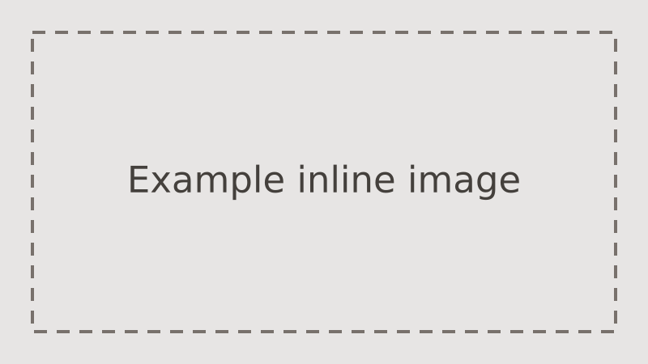

---
# The example entry and authoring template (spec 0002). Copy this folder to
# start a write up, then follow docs/specs/0002-content-model/authoring.md.
# Delete this folder once the first real entry lands.
title: Example project
summary: A placeholder project that shows every field a write up can use.
outcome: Gave every future write up a template to copy.
kind: personal
client:
  name: Example Client
  description: A stand in for the people the work was for
role: Sole engineer
team: Just me
start: '2024-03'
end: '2025-01'
stack:
  - typescript
  - astro
services:
  - frontend
cover: ./cover.png
coverAlt: A grey placeholder card reading "Example project cover, 1200 by 630"
metrics:
  - value: '19'
    label: fields in a project entry
  - value: '3'
    label: required case study sections
links:
  - kind: code
    url: https://github.com/toyinogun/og-website
  - kind: live
    url: https://toyintest.org
    label: See the site
order: 1
featured: true
draft: true
---

## Problem

Say what was wrong or missing, and for whom. A hiring reader wants to see how you framed the problem; a client reader wants to recognise their own.

## Approach

Say what you did and why, including the choices you rejected. Images live in this folder and are linked with a relative path:

### Sub headings are free

Level three headings and deeper can go anywhere inside a section.

## Outcome

Say what changed, with the evidence. Put the headline numbers in `metrics` above, not only here.
